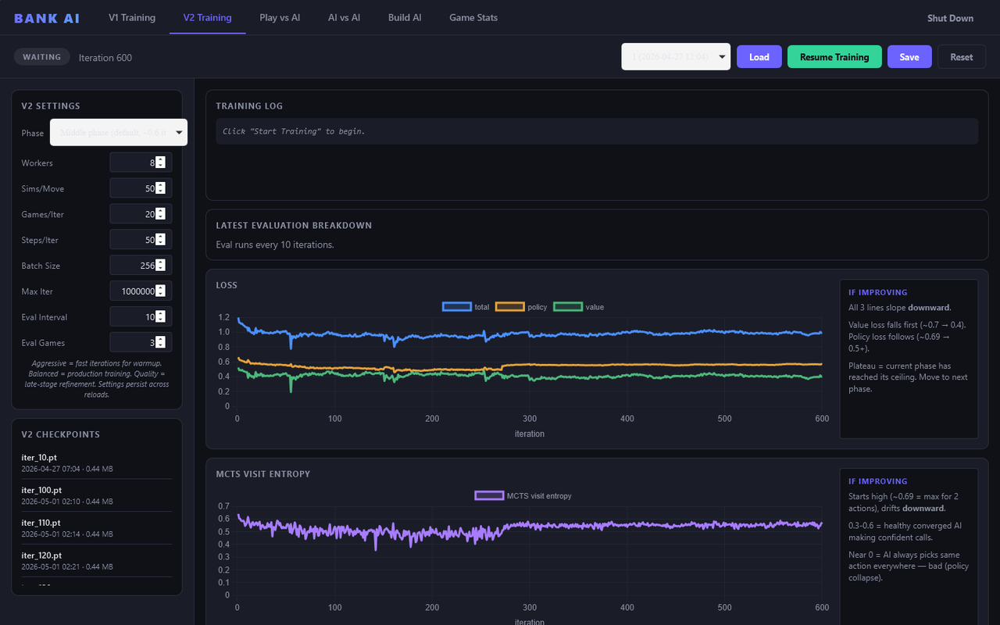
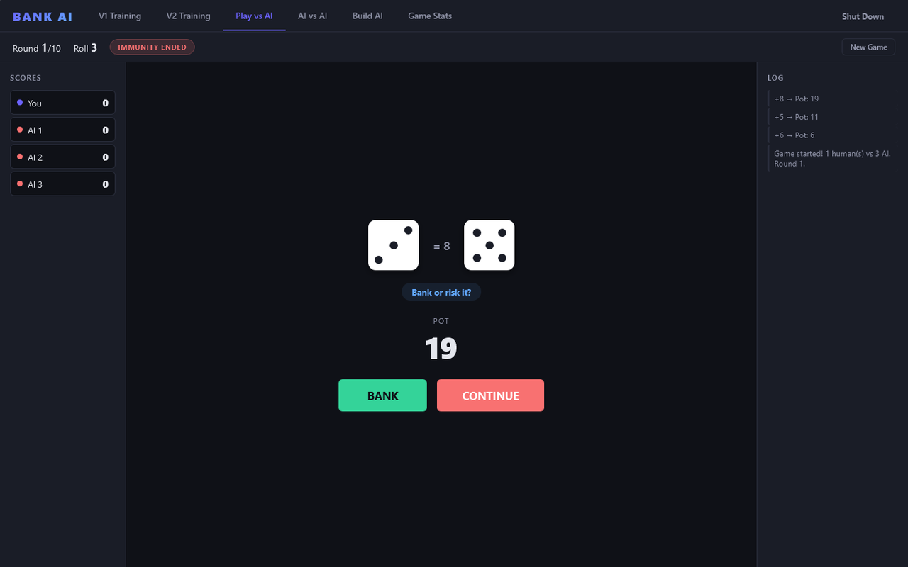
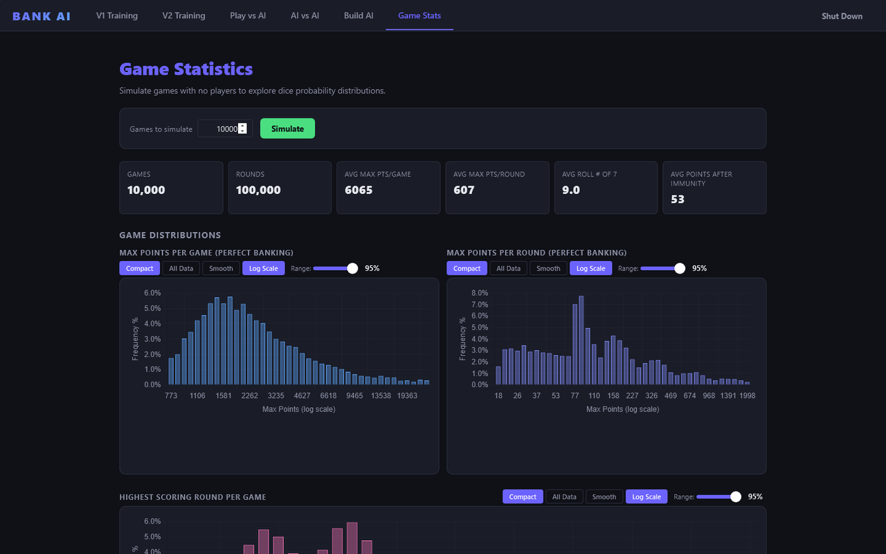
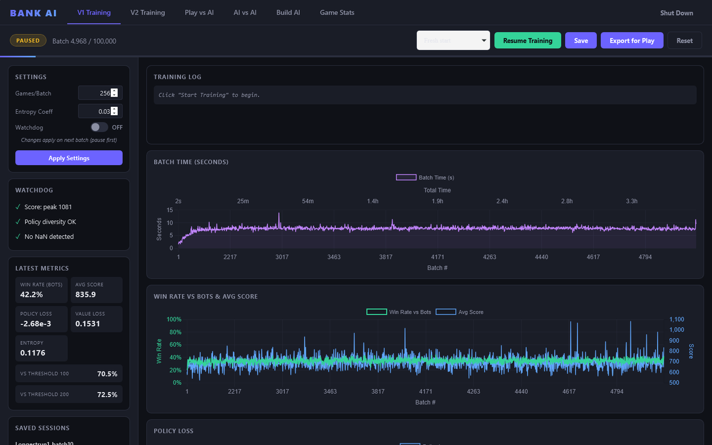

# Bank Pro AI

A PyTorch AI that teaches itself the dice game **Bank** through self-play, plus a local dashboard to train it, watch it learn, and play against it. It's the bigger sibling of [bank-ai-trainer](https://github.com/TimothyHadfield/bank-ai-trainer), which runs in the browser.

Runs on your own computer (Windows, Python) · best on a laptop

<p align="center">
  
</p>

<p align="center">
  
  &nbsp;
  
</p>

## Features
- **Two AI approaches** — v1 learns with PPO (a policy-gradient method); v2 is AlphaZero-style, a neural network guiding Monte Carlo Tree Search.
- **Self-play training** — the AI learns only by playing against itself, with parallel worker processes for v2.
- **Live training dashboard** — start, pause and save runs, and watch win rate, loss and entropy charts update as it learns.
- **Play vs AI** — a full game of Bank against 1–5 AI opponents, with animated dice and keyboard shortcuts.
- **AI vs AI tournaments** — pit checkpoints against each other and see who scores more.
- **Build AI** — write your own banking strategy in code and test it over thousands of games.
- **Game stats** — simulate thousands of games to see how the dice really behave (average max points, when the 7 hits, and more).
- **Tested** — unit tests for the game rules, network, MCTS, self-play and dashboard.

<p align="center">
  
</p>

## Run it
Needs Python 3 and PyTorch (CPU is fine).

```
pip install -r bank-ai-v1-ppo/requirements.txt
```

Then double-click **`BankAI.bat`** (or run `python dashboard/server.py` inside `bank-ai-v1-ppo/`) and open <http://localhost:5001>. Nothing trains until you press a start button.

- `BankAI-v2.bat` opens the v2-only dashboard on port 5002.
- Train v2 from the command line: `cd bank-ai-v2-mcts` then `python train.py`.
- Run a test file: `cd bank-ai-v2-mcts` then e.g. `python tests/test_environment.py` (each test file runs on its own).

One trained model per version is included so you can play right away; the full training history isn't (it's large), so train more from the dashboard. The rules are in [GAME_RULES.md](bank-ai-v2-mcts/GAME_RULES.md) and the v2 design notes in [PLAN.md](bank-ai-v2-mcts/PLAN.md).

## Built with
Python, PyTorch and NumPy for the AI; a small Python web server with plain HTML, JavaScript and Chart.js for the dashboard.
